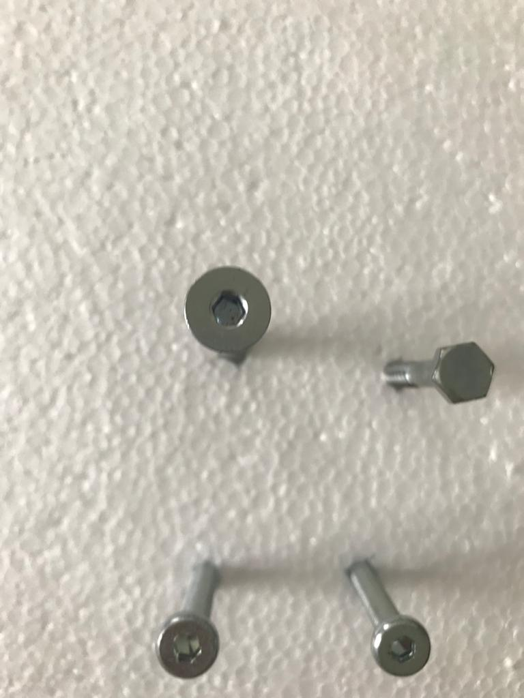
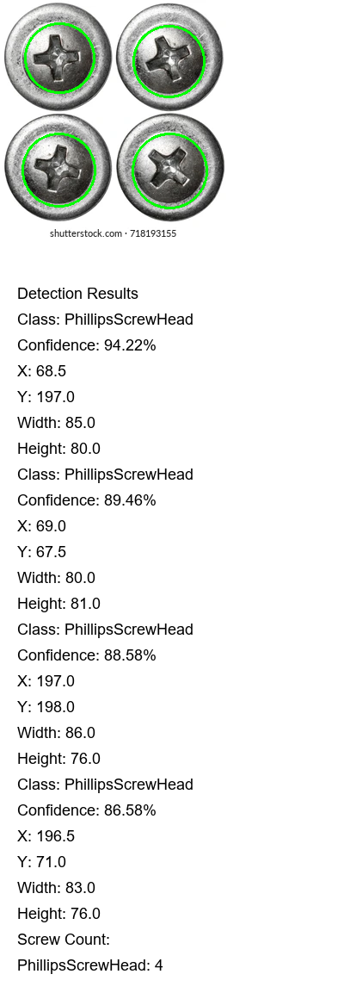

# 🔩 Screw Head Detection & Automated Counter


A full-stack computer vision web application built with **Flask**, **OpenCV**, and **Roboflow Inference** that automatically detects, annotates, and counts screw heads in uploaded images—generating a downloadable visual report with a breakdown table by screw type.

---

## 📸 Detection Results (Before & After)

| Original Input (Before) | Annotated Detection & Count Summary (After) |
| :---: | :---: |
|  |  |

> **What happens under the hood:**
> 1. **Inference:** The uploaded image is sent to the `full-screw-head-detection/2` object detection model via the Roboflow API.
> 2. **Annotation:** OpenCV draws green circular markers around each detected screw head.
> 3. **Summary Table:** Pillow/OpenCV generates a structured count summary image grouped by screw head class and vertically merges it with the annotated image.

---

## ✨ Key Features

* **Multi-Image Batch Processing:** Upload multiple images simultaneously through a responsive Tailwind CSS + jQuery interface with sequential AJAX processing.
* **Automated Class-Wise Counting:** Identifies different screw head types and aggregates total counts into an appended visual table.
* **Instant Preview & Download:** View processed composite outputs directly in the browser and download high-resolution PNG reports with one click.

---

## 🛠️ Tech Stack

* **Backend:** Python 3, Flask 3.1.0
* **Computer Vision & Image Processing:** OpenCV (`opencv-python`), Pillow (`PIL`), NumPy
* **Detection Model:** Roboflow Hosted Inference API (`full-screw-head-detection/2`)
* **Frontend:** HTML5, Tailwind CSS, jQuery (AJAX)

---

## 📁 Project Structure

```text
screw-head-detection/
├── main.py                # Flask server, Roboflow API integration, OpenCV annotation & table generator
├── requirements.txt       # Project dependencies
├── templates/
│   └── index.html         # Multi-file upload UI & dynamic result renderer
├── uploads/               # Raw uploaded input images
└── static/                # Generated outputs (processed_*.png, table_*.png, final_output_*.png)
